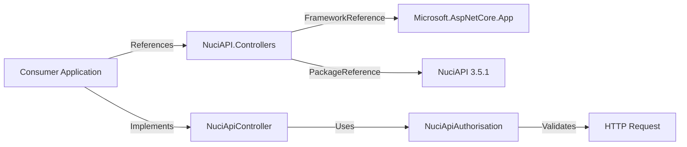
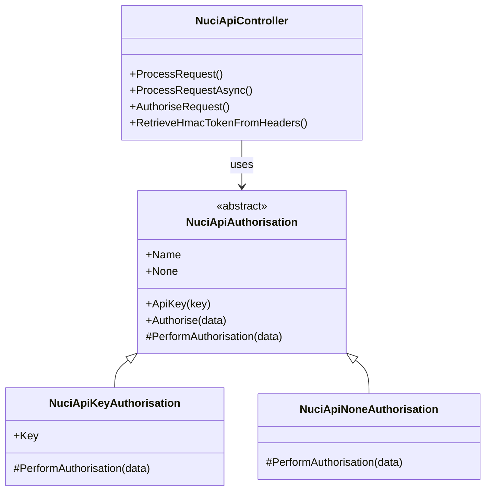
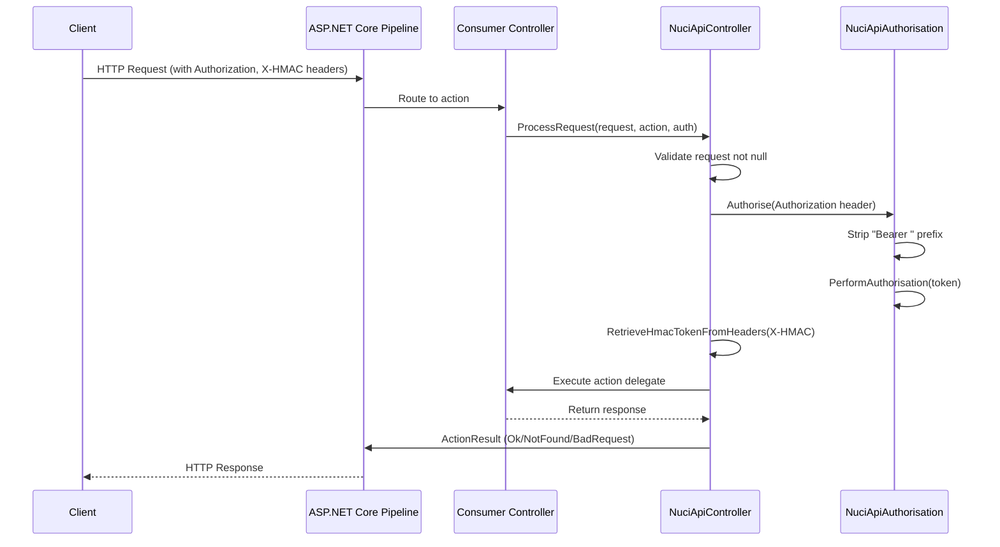
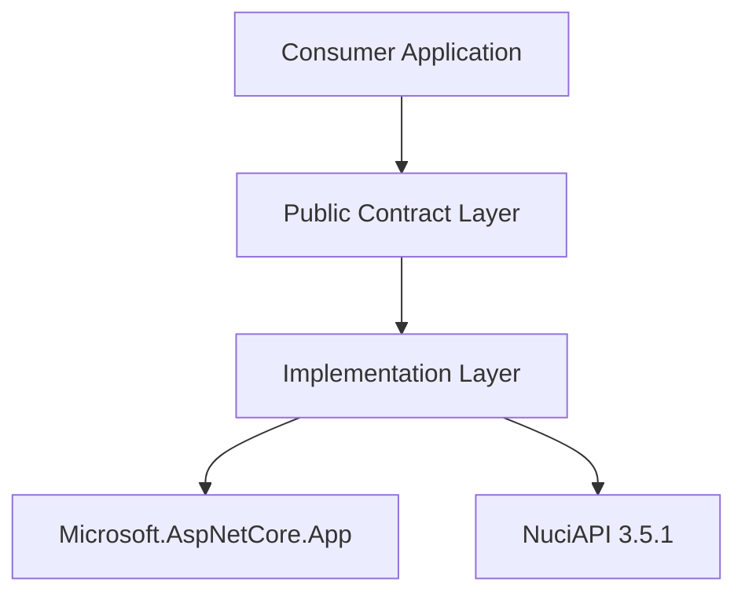

# NuciAPI.Controllers Architecture

This document describes the current architecture of the NuciAPI.Controllers library, a .NET 10.0 class library providing base controller classes and authorisation abstractions for ASP.NET Core REST APIs.

## 📑 Table of Contents

- [Purpose](#-purpose)
- [System Context](#-system-context)
- [Architectural Style](#-architectural-style)
- [Runtime Flow](#-runtime-flow)
- [Components](#-components)
- [Interfaces and Integrations](#-interfaces-and-integrations)
- [Cross-Cutting Concerns](#-cross-cutting-concerns)
- [Dependency Direction and Rules](#-dependency-direction-and-rules)
- [External Dependencies](#-external-dependencies)
- [Deployment and Operations](#-deployment-and-operations)
- [Compatibility Contracts](#-compatibility-contracts)
- [Testing and Verification](#-testing-and-verification)
- [Design Constraints](#-design-constraints)
- [Extension Points](#-extension-points)
- [Related Documentation](#-related-documentation)

## 🎯 Purpose

NuciAPI.Controllers is a library that provides reusable base controller classes and authorisation abstractions for building REST APIs with ASP.NET Core. It targets library consumers who need standardised request processing, HMAC token handling, and pluggable authorisation strategies. The architecture documents the public contracts, internal module boundaries, dependency direction, and extension points that consumers and contributors rely upon.

## 🌐 System Context



The principal external boundaries are:
- **Consumer Application:** References the NuGet package; implements controllers deriving from `NuciApiController`; supplies authorisation strategy via `NuciApiAuthorisation` factory methods.
- **ASP.NET Core (Microsoft.AspNetCore.App):** Provides `ControllerBase`, `ActionResult`, model binding, and HTTP pipeline integration. The library has a framework reference, not a package dependency.
- **NuciAPI 3.5.1:** Supplies `NuciApiRequest`, `NuciApiResponse`, `NuciApiErrorResponse`, `NuciApiSuccessResponse` base types used in request/response processing.

## 🏗️ Architectural Style

**Library / SDK with Abstract Base Classes and Strategy Pattern**

The library exposes abstract base classes (`NuciApiController`, `NuciApiAuthorisation`) that consumers extend or compose. Authorisation uses the Strategy pattern via `NuciApiAuthorisation` subclasses (`NuciApiKeyAuthorisation`, `NuciApiNoneAuthorisation`). The library has no runtime of its own; it executes entirely within the consumer's ASP.NET Core request pipeline.

Consequences:
- Consumers control instantiation and lifetime via standard ASP.NET Core controller activation.
- Public API surface is the abstract base classes and factory methods; internal implementation details are not exposed.
- Versioning follows SemVer on the NuGet package; breaking changes require major version bump.



The principal architecture boundaries are:
- **Public Contract Layer:** `NuciApiController`, `NuciApiAuthorisation`, factory methods (`None`, `ApiKey`). Consumers depend only on this layer.
- **Implementation Layer:** Concrete authorisation strategies, HMAC header parsing, request validation helpers. Not visible to consumers.

## 🔄 Runtime Flow



The principal runtime sequence is:
1. ASP.NET Core routes request to consumer's controller action.
2. Consumer calls `ProcessRequest`/`ProcessRequestAsync` with request DTO, action delegate, and authorisation strategy.
3. Base controller validates request is not null; returns `BadRequest` if null.
4. Base controller invokes `AuthoriseRequest` with the supplied `NuciApiAuthorisation`.
5. Authorisation strategy validates the `Authorization` header (Bearer token parsing) via `PerformAuthorisation`.
6. Base controller extracts `X-HMAC` header into request DTO's `HmacToken` property.
7. Action delegate executes; result wrapped in `Ok`, `NotFound` (for null GET responses), or `BadRequest`.

## 🧩 Components

| Component | Responsibility | Principal Dependencies | Lifetime or Ownership |
|-----------|----------------|------------------------|-----------------------|
| `NuciApiController` | Abstract base controller; request validation, authorisation orchestration, HMAC extraction, response wrapping | `Microsoft.AspNetCore.Mvc.ControllerBase`, `NuciApiAuthorisation`, `NuciAPI.Requests`, `NuciAPI.Responses` | Per-request (ASP.NET Core controller lifetime) |
| `NuciApiAuthorisation` | Abstract authorisation strategy; Bearer token parsing, factory methods for None/ApiKey | `System.Security.Authentication`, `System.Text.RegularExpressions` | Per-request (created via factory per call) |
| `NuciApiKeyAuthorisation` | API key validation strategy; compares supplied key to configured key | `NuciApiAuthorisation` | Per-request (stateless) |
| `NuciApiNoneAuthorisation` | No-op authorisation strategy; always succeeds | `NuciApiAuthorisation` | Per-request (singleton via `None` property) |

## 🔌 Interfaces and Integrations

| Interface or Integration | Direction | Contract | Owner | Failure Semantics |
|--------------------------|-----------|----------|-------|-------------------|
| `NuciApiController.ProcessRequest` | Inbound (consumer calls) | Generic `TRequest : NuciApiRequest`, `Action`/`Func<Task>`, `NuciApiAuthorisation` | `NuciApiController` | Returns `BadRequest` for null request; propagates `AuthenticationException` from authorisation |
| `NuciApiAuthorisation.Authorise` | Inbound (base controller calls) | `string` authorisation header (Bearer token) | `NuciApiAuthorisation` | Throws `AuthenticationException` for missing/invalid token |
| `NuciApiRequest.HmacToken` | Inbound (header → DTO) | `string` property populated from `X-HMAC` header | `NuciApiController` | Silently ignores missing/empty header |
| ASP.NET Core Controller Activation | Inbound (framework) | Standard `ControllerBase` derivation | Consumer application | Framework-managed; library has no control |

## 🧵 Cross-Cutting Concerns

### Security and Privacy

- **Trust Boundaries:** The library executes within the consumer's process; no separate trust boundary. Consumer controls deployment and network exposure.
- **Authentication:** Delegated to `NuciApiAuthorisation` strategies. `NuciApiKeyAuthorisation` performs constant-time string comparison (via `string.Equals`). `NuciApiNoneAuthorisation` performs no validation.
- **Authorisation:** Not implemented; the library provides authentication (identity verification) only. Authorisation (permission checks) is consumer responsibility.
- **Input Validation:** Request null-check only. HMAC token is URL-decoded and stored on request DTO without validation.
- **Secret Injection:** API key supplied by consumer at call site (`NuciApiAuthorisation.ApiKey("key")`). Library does not read configuration or environment.
- **Sensitive Data Handling:** No logging, telemetry, or persistence. The library processes headers in-memory only.

### Error Handling

- **Request Validation:** Null request → `BadRequest(NuciApiErrorResponse.InvalidRequest)`.
- **Authentication Failure:** `AuthenticationException` thrown from `PerformAuthorisation` → propagates to ASP.NET Core exception handling middleware (consumer configures).
- **Action Execution:** Exceptions from consumer's action delegate propagate unhandled; library does not catch.
- **Null Response (GET):** Null response from action on HTTP GET → `NotFound(NuciApiErrorResponse.NotFound)`.

### Observability

- **No Built-in Observability:** The library emits no logs, metrics, traces, or health checks. Consumers implement observability via ASP.NET Core middleware or action filters.

### Configuration

| Configuration Area | Source | Responsibility | Override or Secret Policy |
|--------------------|--------|----------------|---------------------------|
| API Key | Consumer code (call site) | `NuciApiKeyAuthorisation` key comparison | Consumer manages secret storage (Key Vault, env var, config) |
| HMAC Header Name | Hard-coded (`X-HMAC`) | `RetrieveHmacTokenFromHeaders` | Not configurable |
| Authorization Header Parsing | Hard-coded (Bearer scheme, case-insensitive) | `NuciApiAuthorisation.Authorise` | Not configurable |

### Concurrency and Resource Use

- **Stateless:** All components are stateless per request. `NuciApiNoneAuthorisation.None` returns a singleton instance; `NuciApiKeyAuthorisation` is instantiated per call.
- **No Shared State:** No static mutable state, caches, or connection pools.
- **Async Support:** `ProcessRequestAsync` overloads use `ConfigureAwait(false)`; no synchronization context capture.
- **Capacity Limits:** None imposed by library; bounded by ASP.NET Core request limits and consumer infrastructure.

## 🧭 Dependency Direction and Rules



The principal dependency rules are:
- **Consumer → Public Contract Only:** Consumers must not depend on concrete authorisation classes or internal helpers.
- **Public Contract → Implementation:** `NuciApiController` uses `NuciApiAuthorisation` abstract base; factory methods return concrete implementations.
- **Implementation → Framework/Packages:** Internal code references `Microsoft.AspNetCore.Mvc`, `NuciAPI` DTOs, `System.Security.Authentication`.
- **Prohibited:** Consumer referencing `NuciApiKeyAuthorisation` or `NuciApiNoneAuthorisation` directly (use factory methods). Library referencing consumer types.

## 📦 External Dependencies

| Dependency | Responsibility | Integration Boundary | Architectural Consequence |
|------------|----------------|----------------------|---------------------------|
| `Microsoft.AspNetCore.App` (FrameworkReference) | Controller base, action results, HTTP pipeline, model binding | `NuciApiController` derives from `ControllerBase`; uses `ActionResult`, `BadRequest`, `Ok`, `NotFound` | Version tied to ASP.NET Core 10.0; consumer must use compatible runtime |
| `NuciAPI 3.5.1` (PackageReference) | Request/response base DTOs (`NuciApiRequest`, `NuciApiResponse`, `NuciApiErrorResponse`, `NuciApiSuccessResponse`) | Generic constraints on `ProcessRequest`; response wrapping | Consumer must reference same NuciAPI version; breaking changes in NuciAPI require coordinated update |

## 🚀 Deployment and Operations

| Concern | Current Design | Architectural Consequence |
|---------|----------------|---------------------------|
| Deployment Unit | NuGet package (`NuciAPI.Controllers` 2.3.1) | Consumers restore via `dotnet add package`; no separate deployment |
| Process Topology | In-process library within consumer's ASP.NET Core application | No independent scaling, health checks, or lifecycle |
| Persistent State | None | No migrations, backups, or state recovery |
| Filesystem/Network | None directly; consumer's ASP.NET Core handles I/O | Library imposes no infrastructure requirements |
| Scaling | Consumer-controlled (horizontal via ASP.NET Core) | Library adds no scaling constraints |
| Startup/Shutdown | No library-specific initialization or disposal | Consumer's `Program.cs`/`Startup.cs` unchanged |
| Operator Outputs | None | No logs, metrics, or diagnostics emitted by library |

## 🛡️ Compatibility Contracts

| Contract | Owner | Invariant | Verification | Change Policy |
|----------|-------|-----------|--------------|---------------|
| `NuciApiController.ProcessRequest` signatures | `NuciApiController` | Generic constraints (`TRequest : NuciApiRequest`, `TResponse : NuciApiResponse`), parameter order, return type `ActionResult`/`Task<ActionResult>` | Compile-time (consumer build) | Non-breaking only in minor/patch; signature changes require major version |
| `NuciApiAuthorisation` factory methods | `NuciApiAuthorisation` | `None` returns `NuciApiNoneAuthorisation`; `ApiKey(string)` returns `NuciApiKeyAuthorisation` | Compile-time + unit tests | Factory method signatures frozen; new strategies via new factory methods |
| `NuciApiRequest.HmacToken` property | `NuciAPI` (external) | `string` property set by `RetrieveHmacTokenFromHeaders` | Consumer test | Depends on NuciAPI package; library adapts to NuciAPI changes |
| `Authorization` header parsing (Bearer) | `NuciApiAuthorisation` | Case-insensitive "Bearer " prefix stripped before `PerformAuthorisation` | Unit tests | Behaviour fixed; new schemes require new authorisation type |

## ✅ Testing and Verification

The library has no dedicated test project in this repository. Verification is performed by consumers during integration.

Execute the principal automated verification with:

```bash
# Restore dependencies
dotnet restore

# Build (verifies compile-time contracts)
dotnet build --no-restore

# Consumer integration test (example)
dotnet test --no-build --verbosity normal
```

Material coverage gaps:
- No unit tests for `NuciApiController` request validation, HMAC extraction, or authorisation orchestration.
- No unit tests for `NuciApiKeyAuthorisation` key comparison (constant-time), `NuciApiNoneAuthorisation` no-op.
- No contract tests verifying `ProcessRequest` overload signatures across versions.

## ⚠️ Design Constraints

- **Target Framework:** .NET 10.0 only (`net10.0`); no multi-targeting.
- **ImplicitUsings Disabled:** Explicit `using` directives required; affects source compatibility for consumers on older .NET versions.
- **Nullable Enabled:** Project uses nullable reference types; public API returns non-null `ActionResult` but action delegates may return null (handled for GET).
- **No Telemetry/Logging:** By design; consumers must add their own.
- **Single Authorisation per Request:** `ProcessRequest` accepts one `NuciApiAuthorisation`; composite authorisation requires consumer wrapper.
- **HMAC Header Fixed:** `X-HMAC` header name not configurable; consumers using different header must fork or wrap.

## ⚙️ Extension Points

| Extension Point | Contract | Registration / Integration |
|-----------------|----------|----------------------------|
| Custom Authorisation | Derive from `NuciApiAuthorisation`, implement `PerformAuthorisation(string)` | Consumer instantiates and passes to `ProcessRequest`; no library registration |
| Custom Request Processing | Derive from `NuciApiController`, override `ProcessRequest`/`ProcessRequestAsync` | Consumer's controller inherits custom base; no library registration |
| Custom Response Types | Use `ProcessRequest<TRequest, TResponse>` with `TResponse : NuciApiResponse` | Consumer defines DTO inheriting `NuciApiResponse`; no library registration |

## 📚 Related Documentation

- [README.md](./README.md) — Installation, usage, capabilities overview
- [PRIVACY.md](./PRIVACY.md) — Data handling statement (no personal data collected)
- [SECURITY.md](./SECURITY.md) — Supported versions, vulnerability reporting, disclosure policy
- [CONTRIBUTING.md](./CONTRIBUTING.md) — Development setup, code style, pull request process
- [CODE_OF_CONDUCT.md](./CODE_OF_CONDUCT.md) — Community participation standards
- [LICENSE](./LICENSE) — GPL-3.0-or-later terms