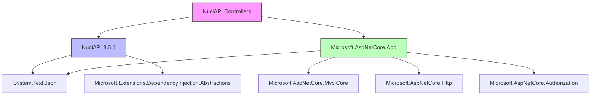

# Dependencies

## Direct Dependencies

### NuGet Packages

| Package | Version | Purpose | License |
|---------|---------|---------|---------|
| `NuciAPI` | 3.5.1 | Core primitives (`NuciApiErrorResponse`) | GPL-3.0-or-later |
| `Microsoft.AspNetCore.App` | Framework | ASP.NET Core base (ControllerBase, etc.) | MIT/Apache-2.0 |

### NuciAPI (3.5.1)

**Transitive dependencies of NuciAPI 3.5.1:**

```
NuciAPI 3.5.1
├── System.Text.Json (>= 8.0.0) - Built-in .NET 10
├── Microsoft.Extensions.DependencyInjection.Abstractions (>= 8.0.0) - Built-in .NET 10
└── (no other external dependencies)
```

**Used types from NuciAPI:**
- `NuciApiErrorResponse` - Structured error responses (`InvalidRequest`, `NotFound`)

### Microsoft.AspNetCore.App (Framework Reference)

**Provides (built into .NET 10 runtime):**
- `Microsoft.AspNetCore.Mvc.Core` - `ControllerBase`, `ActionResult`, `BadRequest`, `Ok`, `NotFound`
- `Microsoft.AspNetCore.Http` - `HttpRequest`, `HttpResponse`, `IHeaderDictionary`
- `Microsoft.AspNetCore.Authorization` - `AuthenticationException`
- `Microsoft.Extensions.Logging.Abstractions` - `ILogger` (not used by library)
- `System.Text.Json` - JSON serialization

## Dependency Graph

```
NuciAPI.Controllers (net10.0)
├── NuciAPI 3.5.1
│   ├── System.Text.Json (framework)
│   └── Microsoft.Extensions.DependencyInjection.Abstractions (framework)
└── Microsoft.AspNetCore.App (framework)
    ├── Microsoft.AspNetCore.Mvc.Core
    ├── Microsoft.AspNetCore.Http
    ├── Microsoft.AspNetCore.Authorization
    └── System.Text.Json
```

## Version Compatibility Matrix

| NuciAPI.Controllers | .NET | NuciAPI | ASP.NET Core |
|---------------------|------|---------|--------------|
| 2.3.1 | 10.0 | 3.5.1 | 10.0 |
| 2.2.x | 9.0 | 3.4.x | 9.0 |
| 2.1.x | 8.0 | 3.3.x | 8.0 |

**Policy:** Major version of NuciAPI.Controllers tracks .NET major version.

## Dependency Analysis

### Why NuciAPI?

| Reason | Detail |
|--------|--------|
| Shared error contract | `NuciApiErrorResponse` used across ecosystem |
| Version alignment | NuciAPI 3.5.1 targets net10.0 |
| Minimal surface | Only `NuciApiErrorResponse` used |
| No duplication | Avoids redefining error types |

### Why Microsoft.AspNetCore.App (Framework Reference)?

| Reason | Detail |
|--------|--------|
| No version conflict | Uses runtime-installed version |
| Smaller package | No DLLs in nupkg |
| Automatic updates | Security patches via .NET updates |
| Standard ASP.NET Core | Required for ControllerBase |

## Transitive Dependency Risk Assessment

| Risk | Assessment | Mitigation |
|------|------------|------------|
| NuciAPI breaking change | Low (only `NuciApiErrorResponse` used) | Pin version, test on update |
| ASP.NET Core breaking change | Low (LTS + standard APIs) | Target net10.0, test on preview |
| Diamond dependency | None (single NuGet dep) | N/A |
| License conflict | GPL-3.0 (NuciAPI) + MIT (ASP.NET) | GPL-3.0 compatible |

## Package Size Impact

| Component | Size (approx) |
|-----------|---------------|
| NuciAPI.Controllers.dll | ~50 KB |
| NuciAPI.dll (transitive) | ~30 KB |
| ASP.NET Core (framework) | 0 (shared runtime) |
| **Total download** | **~80 KB** |

## Dependency Update Policy

| Dependency | Update Cadence | Testing |
|------------|----------------|---------|
| NuciAPI | Patch: immediate, Minor: weekly, Major: planned | Full test suite |
| .NET / ASP.NET Core | Patch: monthly, Minor: per release | CI on preview |
| NuciAPI.Controllers own version | Semantic versioning | CI on every commit |

## Vulnerability Scanning

```bash
# Scan for vulnerabilities
dotnet list package --vulnerable --include-transitive

# Audit NuGet packages
dotnet nuget audit
```

**No known vulnerabilities** as of 2026-11-03.

## License Compliance

| Package | License | Compatible with GPL-3.0? |
|---------|---------|-------------------------|
| NuciAPI | GPL-3.0-or-later | Yes (same) |
| Microsoft.AspNetCore.App | MIT / Apache-2.0 | Yes |
| System.Text.JSON | MIT | Yes |

**Result:** NuciAPI.Controllers can be GPL-3.0-or-later.

## Excluded Dependencies (Intentional)

| Category | Example | Reason |
|----------|---------|--------|
| Logging | Serilog, NLog, Microsoft.Extensions.Logging | Consumer choice |
| Configuration | Microsoft.Extensions.Configuration | No config needed |
| DI Container | Autofac, Lamar | Use built-in |
| HTTP Client | HttpClientFactory, Refit, RestSharp | Consumer choice |
| Validation | FluentValidation, DataAnnotations | Consumer choice |
| Mapping | AutoMapper, Mapster | Consumer choice |
| Resilience | Polly, Fusi | Consumer choice |
| Testing | xUnit, NUnit, Moq | Test project only |

## Consumer Dependency Guidance

### Minimum Consumer Dependencies

```xml
<PackageReference Include="NuciAPI.Controllers" Version="2.3.1" />
```

### Recommended Consumer Stack

```xml
<!-- Core -->
<PackageReference Include="NuciAPI.Controllers" Version="2.3.1" />

<!-- Logging -->
<PackageReference Include="Serilog.AspNetCore" Version="8.0.0" />
<PackageReference Include="Serilog.Sinks.Console" Version="5.0.0" />

<!-- Configuration -->
<PackageReference Include="Microsoft.Extensions.Configuration.UserSecrets" Version="8.0.0" />

<!-- Validation (optional) -->
<PackageReference Include="FluentValidation.AspNetCore" Version="11.3.0" />

<!-- Resilience (optional) -->
<PackageReference Include="Polly.Extensions.Http" Version="3.0.0" />

<!-- Testing -->
<PackageReference Include="Microsoft.AspNetCore.Mvc.Testing" Version="10.0.0" />
<PackageReference Include="NUnit" Version="4.0.0" />
<PackageReference Include="Moq" Version="4.20.0" />
```

## Dependency Visualization

