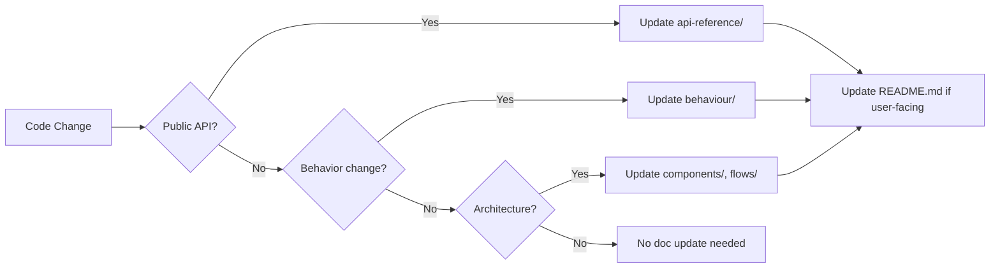

# Documentation Maintenance

## Principles

| Principle | Practice |
|-----------|----------|
| **Accuracy over completeness** | Wrong docs worse than missing docs |
| **Code as source of truth** | Docs reflect implementation, not aspirations |
| **Version alignment** | Docs versioned with code (same repo) |
| **Automation first** | Generate where possible, write where necessary |

## Documentation Types

### 1. Root Documents (GitHub Standard)

| File | Update Trigger | Owner |
|------|----------------|-------|
| `README.md` | Every release, major feature | Maintainer |
| `PRIVACY.md` | Data handling changes | Maintainer |
| `SECURITY.md` | Vulnerability process changes | Security team |
| `CONTRIBUTING.md` | Process changes | Maintainer |
| `CODE_OF_CONDUCT.md` | Community standards update | Maintainer |
| `ARCHITECTURE.md` | Architectural changes | Architect |
| `LICENSE` | License change | Legal |

### 2. Technical Documentation (docs/)

| Category | Files | Update Trigger |
|----------|-------|----------------|
| Architecture | `architecture.md`, `components/*.md` | Structural changes |
| Flows | `flows/*.md` | Logic changes |
| API Reference | `api-reference/*.md` | Public API changes |
| Behaviour | `behaviour/*.md` | Behavior changes |
| Cross-cutting | `security.md`, `logging.md`, etc. | Concern changes |
| Guides | `guides/*.md` | UX improvements |
| Operations | `build-and-deployment.md`, `change-guide.md` | Process changes |
| Repository | `repository-*.md` | Structure changes |

## Update Workflow

### For Code Changes



### For Releases

```bash
# Pre-release checklist
- [ ] CHANGELOG.md updated (if exists)
- [ ] Version in csproj matches release
- [ ] README.md badges current
- [ ] change-guide.md has new version entry
- [ ] API reference matches public surface
- [ ] No broken internal links
```

## Link Validation

### Internal Links

```bash
# Check all .md files for broken links
find docs -name "*.md" -exec markdown-link-check {} \;

# Or use GitHub Action
- uses: gaurav-nelson/github-action-markdown-link-check@v1
  with:
    config-file: '.markdown-link-check.json'
```

### Configuration

```json
// .markdown-link-check.json
{
  "ignorePatterns": [
    "https://github.com/hmlendea/nuciapi.controllers/issues/new/choose"
  ],
  "replacementPatterns": [
    {
      "pattern": "^\\.\\./",
      "replacement": "https://github.com/hmlendea/nuciapi.controllers/blob/dev/"
    }
  ]
}
```

## Content Standards

### Headings

```markdown
# H1: Document title (one per file)
## H2: Major section
### H3: Subsection
#### H4: Detail (avoid deeper)
```

### Code Blocks

````markdown
```csharp
// Always specify language
public class Example { }
```

```bash
# Shell commands
dotnet build
```

```json
// JSON config
{ "key": "value" }
```
````

### Tables

```markdown
| Column 1 | Column 2 | Column 3 |
|----------|----------|----------|
| Left | Center | Right |
| Data | Data | Data |
```

### Admonitions

```markdown
> **Note:** Informational

> **Warning:** Potential issue

> **Important:** Critical information
```

### Cross-References

```markdown
See [Architecture](../architecture.md) for details.
See [NuciApiController](../api-reference/nuciapicontroller.md) for API.
```

## Automation

### API Reference Generation

```xml
<!-- NuciAPI.Controllers.csproj -->
<PropertyGroup>
  <GenerateDocumentationFile>true</GenerateDocumentationFile>
  <DocumentationFile>bin\$(Configuration)\$(TargetFramework)\NuciAPI.Controllers.xml</DocumentationFile>
</PropertyGroup>
```

```bash
# Generate markdown from XML (using docfx or similar)
docfx metadata -o api-docs
docfx build -o _site
```

### Diagram Validation

```bash
# Mermaid CLI for diagram validation
npx -y @mermaid-js/mermaid-cli -i docs/**/*.md -o /dev/null
```

### Spell Check

```bash
# cspell
npx cspell "docs/**/*.md" "README.md" "*.md"
```

```json
// cspell.json
{
  "words": ["NuciAPI", "Mlendea", "Horațiu", "net10.0", "HMACSHA256", "Argon2", "BCrypt"],
  "ignorePaths": ["node_modules", ".git", "obj", "bin"]
}
```

## Review Process

### PR Requirements

| Change Type | Doc Review Required |
|-------------|---------------------|
| Public API | Yes (api-reference) |
| Behavior | Yes (behaviour/) |
| Architecture | Yes (components/, flows/) |
| Config/Build | Yes (build-and-deployment.md) |
| Internal only | No |

### Review Checklist

- [ ] All public types/members documented
- [ ] Breaking changes in change-guide.md
- [ ] Examples compile and run
- [ ] Links resolve
- [ ] Diagrams render
- [ ] Spelling clean
- [ ] Consistent terminology

## Versioning

### Documentation Version = Code Version

```
v2.3.1 (code) → docs at v2.3.1 (same commit)
```

### Historical Versions

- Git tags preserve docs at release points
- No separate versioned doc site (single version in repo)
- For old versions: `git show v2.2.0:docs/architecture.md`

## Deprecation Notices

### In Documentation

```markdown
> **Deprecated** (since v2.3.0): Use `ProcessRequestAsync` instead.
> Removal planned: v3.0.0
```

### In Code (XML Docs)

```csharp
/// <summary>
/// <para><b>Obsolete:</b> Use <see cref="ProcessRequestAsync"/> instead.</para>
/// </summary>
[Obsolete("Use ProcessRequestAsync instead. Removal planned v3.0.0.")]
public ActionResult ProcessRequest(...) { ... }
```

## Metrics

### Quality Indicators

| Metric | Target | Tool |
|--------|--------|------|
| Link validity | 100% | markdown-link-check |
| Spell check | 0 errors | cspell |
| Diagram validity | 100% | mermaid-cli |
| API coverage | 100% public | docfx |
| Reading time | < 10 min/file | Manual |

### Tracking

```bash
# Doc size
wc -w docs/**/*.md

# File count
find docs -name "*.md" | wc -l

# Last updated
git log --oneline --name-only -- docs/ | head -20
```

## Maintenance Schedule

| Frequency | Task |
|-----------|------|
| Every PR | Link check, spell check (CI) |
| Every release | Full review, version updates |
| Quarterly | Dead link audit, terminology audit |
| Annually | Structure review, tooling update |

## Contributing to Docs

### For Contributors

1. Fork repo
2. Edit `.md` files in `docs/` or root
3. Run local checks: `markdown-link-check`, `cspell`
4. Submit PR with "docs:" prefix

### For Maintainers

1. Review for accuracy
2. Verify links render on GitHub
3. Merge to `dev`
4. Released with next version

## Tooling

| Tool | Purpose | Install |
|------|---------|---------|
| `markdown-link-check` | Validate links | `npm i -g markdown-link-check` |
| `cspell` | Spell check | `npm i -g cspell` |
| `@mermaid-js/mermaid-cli` | Validate diagrams | `npm i -g @mermaid-js/mermaid-cli` |
| `docfx` | API reference gen | `dotnet tool install -g docfx` |
| `markdownlint` | Style check | `npm i -g markdownlint-cli` |

## Emergency Updates

### Security Advisory

1. Update `SECURITY.md` immediately
2. Add to `change-guide.md` if version affected
3. Publish patch release
4. Announce via GitHub Security Advisory

### Critical Bug Doc Fix

1. Fix in `docs/` on `dev`
2. Cherry-pick to `main` if needed
3. Include in next patch release