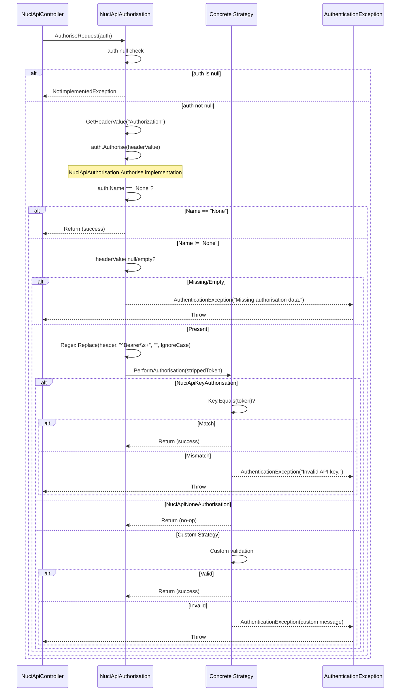

# Authorisation Flow

## Overview

Detailed flow of the authorisation subsystem from `NuciApiController.AuthoriseRequest` through strategy validation.

## Sequence Diagram



## Step-by-Step

### 1. Entry Point: `NuciApiController.AuthoriseRequest`

```csharp
private void AuthoriseRequest(NuciApiAuthorisation authorisation)
{
    if (authorisation is null)
    {
        throw new NotImplementedException("This endpoint has no authorisation specified.");
    }

    authorisation.Authorise(GetHeaderValue("Authorization"));
}
```

**Preconditions:**
- Called after null request check
- `authorisation` parameter from consumer's `ProcessRequest` call

**Behaviour:**
- Null check throws `NotImplementedException` (programming error)
- Extracts `Authorization` header via `GetHeaderValue`
- Delegates to `authorisation.Authorise(headerValue)`

### 2. Base Authorisation: `NuciApiAuthorisation.Authorise`

```csharp
public void Authorise(string authorisationData)
{
    if (Name.Equals(None.Name))
    {
        return;
    }

    if (string.IsNullOrEmpty(authorisationData))
    {
        throw new AuthenticationException("Missing authorisation data.");
    }

    PerformAuthorisation(Regex.Replace(
        authorisationData.Trim(),
        @"^Bearer\s+", "",
        RegexOptions.IgnoreCase));
}
```

**Decision Tree:**
1. `Name == "None"` → Immediate success (short-circuit)
2. `authorisationData` null/empty → `AuthenticationException("Missing authorisation data.")`
3. Otherwise → Strip Bearer prefix → `PerformAuthorisation(token)`

**Bearer Parsing Details:**
- `Trim()` removes leading/trailing whitespace
- Regex `^Bearer\s+` with `IgnoreCase` matches "Bearer ", "bearer ", "BEARER ", etc.
- Removes scheme prefix only; remainder passed as token
- If no Bearer prefix, entire header value passed as token

### 3. Strategy Validation: `PerformAuthorisation`

#### NuciApiKeyAuthorisation

```csharp
protected override void PerformAuthorisation(string apiKey)
{
    if (!Key.Equals(apiKey))
    {
        throw new AuthenticationException("Invalid API key.");
    }
}
```

- `Key` set via factory: `NuciApiAuthorisation.ApiKey("secret")`
- `string.Equals` (ordinal, case-sensitive)
- Throws `AuthenticationException` with generic message
- **Timing vulnerability**: Not constant-time comparison

#### NuciApiNoneAuthorisation

```csharp
protected override void PerformAuthorisation(string authorisationData)
{
    // No authorisation
}
```

- Never actually called (short-circuited in base `Authorise`)
- Exists for interface completeness

#### Custom Strategy

```csharp
protected override void PerformAuthorisation(string token)
{
    // Consumer implementation
    if (!Validate(token))
        throw new AuthenticationException("Custom failure reason");
}
```

- Consumer controls all validation logic
- Must throw `AuthenticationException` on failure
- Token is post-Bearer-stripping string

## Error Handling

| Scenario | Exception | Message | HTTP Status (with middleware) |
|----------|-----------|---------|-------------------------------|
| No authorisation provided | `NotImplementedException` | "This endpoint has no authorisation specified." | 500 |
| Missing Authorization header | `AuthenticationException` | "Missing authorisation data." | 401 |
| Empty Authorization header | `AuthenticationException` | "Missing authorisation data." | 401 |
| Invalid API key | `AuthenticationException` | "Invalid API key." | 401 |
| Custom validation failure | `AuthenticationException` | Consumer-defined | 401 |

## Security Properties

| Property | Status | Notes |
|----------|--------|-------|
| Timing-safe comparison | ❌ No | `string.Equals` vulnerable to timing attacks |
| Token in error messages | ✅ No | Generic messages only |
| Scheme validation | ⚠️ Partial | Only Bearer stripped; any scheme passes to strategy |
| Rate limiting | ❌ No | Consumer responsibility |
| Brute force protection | ❌ No | Consumer responsibility |

## Consumer Responsibilities

1. **Always provide authorisation**: Every `ProcessRequest` call requires non-null `NuciApiAuthorisation`
2. **Handle exceptions**: Configure ASP.NET Core exception middleware for 401 responses
3. **Manage secrets**: API keys from Key Vault, env vars, config — never hard-coded
4. **Custom strategies**: Implement `PerformAuthorisation` for JWT, OAuth, certificates, etc.