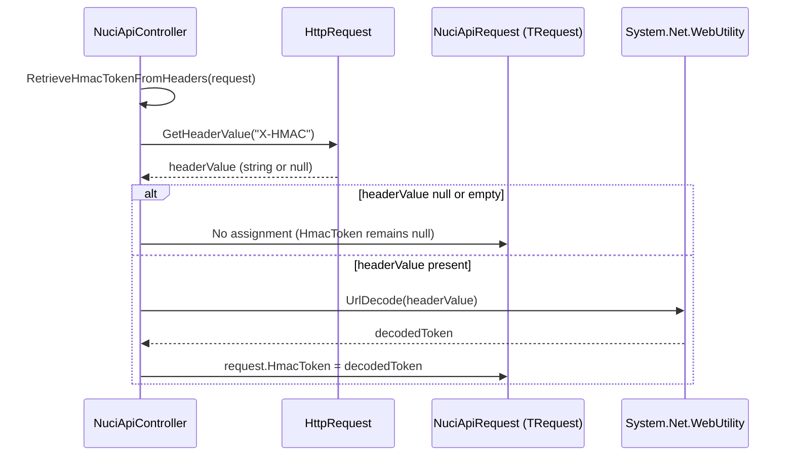

# HMAC Extraction Flow

## Overview

Flow for extracting and decoding the `X-HMAC` header into the request DTO's `HmacToken` property.

## Sequence Diagram



## Implementation

```csharp
private void RetrieveHmacTokenFromHeaders<TRequest>(TRequest request)
    where TRequest : NuciApiRequest
{
    string hmacToken = GetHeaderValue("X-HMAC");

    if (!string.IsNullOrEmpty(hmacToken))
    {
        request.HmacToken = WebUtility.UrlDecode(hmacToken);
    }
}

protected string GetHeaderValue(string headerName)
    => Request.Headers[headerName].FirstOrDefault();
```

## Step-by-Step

### 1. Trigger
- Called from all `ProcessRequest` overloads **after** successful authorisation
- Runs only if authorisation did not throw

### 2. Header Retrieval
```csharp
string hmacToken = GetHeaderValue("X-HMAC");
```
- `GetHeaderValue` uses `Request.Headers[headerName].FirstOrDefault()`
- Returns `null` if header absent, first value if present (multiple values: first wins)
- Header name hard-coded: `X-HMAC`

### 3. Null/Empty Check
```csharp
if (!string.IsNullOrEmpty(hmacToken))
```
- Skips decoding if header absent or empty string
- `HmacToken` property remains `null` (default for `string`)

### 4. URL Decoding
```csharp
request.HmacToken = WebUtility.UrlDecode(hmacToken);
```
- Uses `System.Net.WebUtility.UrlDecode`
- Decodes percent-encoded characters (%XX → byte → char)
- Handles `+` → space (form encoding)
- Assigns to `request.HmacToken` (property from `NuciApiRequest` base class)

### 5. Completion
- Method returns void
- Request DTO now has `HmacToken` populated (or null)
- Consumer action delegate can access `request.HmacToken`

## NuciApiRequest Base Class (from NuciAPI Package)

```csharp
// In NuciAPI.Requests namespace (external package)
public abstract class NuciApiRequest
{
    public string HmacToken { get; set; }
    // Other base properties...
}
```

## Properties

| Property | Value |
|----------|-------|
| Header Name | `X-HMAC` (hard-coded) |
| Decoding | `WebUtility.UrlDecode` (percent + form encoding) |
| Assignment Target | `TRequest.HmacToken` (requires `TRequest : NuciApiRequest`) |
| Timing | After authorisation, before action execution |
| Failure Mode | Silent ignore (missing/empty header → null) |

## Consumer Usage

### Accessing HMAC in Action

```csharp
[HttpPost("secure")]
public ActionResult SecureEndpoint(SecureRequest request)
{
    return ProcessRequest(request, () =>
    {
        var hmac = request.HmacToken; // Available here
        // Verify HMAC signature, timestamp, etc.
    }, NuciApiAuthorisation.ApiKey("key"));
}
```

### Custom HMAC Validation (Consumer Responsibility)

```csharp
protected override ActionResult ProcessRequest<TRequest, TResponse>(
    TRequest request, 
    Func<TResponse> action, 
    NuciApiAuthorisation authorisation)
{
    // Pre-processing: validate HMAC
    if (!ValidateHmac(request.HmacToken, request))
        return Unauthorized();
    
    return base.ProcessRequest(request, action, authorisation);
}
```

## Limitations

| Limitation | Impact |
|------------|--------|
| Fixed header name | Cannot use `X-Signature`, `HMAC`, etc. without forking |
| No validation | Library does not verify HMAC signature, timestamp, replay protection |
| Single header | No support for multiple HMAC headers or algorithms |
| URL decoding only | No base64 decoding, no binary support |
| Silent failure | Missing header → null, no distinction from empty header |

## Security Considerations

- **Replay attacks**: No timestamp/nonce validation in library
- **Algorithm agility**: No algorithm identifier in header
- **Key management**: Consumer must manage HMAC keys separately
- **Timing attacks**: `HmacToken` assignment not constant-time (irrelevant for assignment)

## Extension Options

1. **Override in Custom Base Controller**:
```csharp
protected override void RetrieveHmacTokenFromHeaders<TRequest>(TRequest request)
{
    // Custom header name, decoding, validation
    base.RetrieveHmacTokenFromHeaders(request);
}
```

2. **Pre-process in Action**:
```csharp
var hmac = request.HmacToken;
if (hmac != null) { /* custom decode/validate */ }
```

3. **Custom Authorisation Strategy**: Include HMAC validation in `PerformAuthorisation`