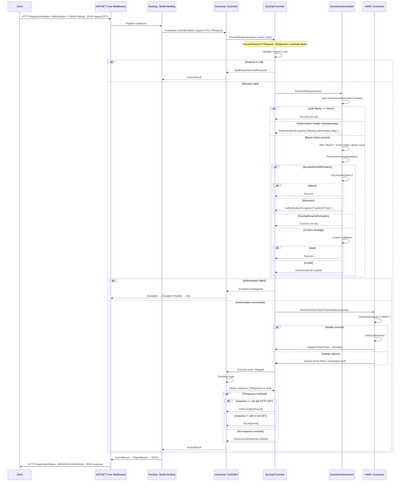

# Request Processing Flow

## Overview

End-to-end flow from HTTP request entering ASP.NET Core pipeline to HTTP response returning to client, showing all NuciAPI.Controllers touchpoints.

## Sequence Diagram



## Step-by-Step Breakdown

### 1. Request Entry (ASP.NET Core)
- Middleware pipeline executes (logging, auth, CORS, etc.)
- Routing matches controller/action
- Model binding creates `TRequest` instance from body/query/route

### 2. Consumer Action Invocation
- Consumer controller action called
- Consumer calls `ProcessRequest` with request, action delegate, authorisation strategy

### 3. Null Request Validation (NuciApiController)
```csharp
if (request is null)
    return BadRequest(NuciApiErrorResponse.InvalidRequest);
```
- First check in all overloads
- Returns 400 before any authorisation

### 4. Authorisation Orchestration (NuciApiController.AuthoriseRequest)
```csharp
private void AuthoriseRequest(NuciApiAuthorisation authorisation)
{
    if (authorisation is null)
        throw new NotImplementedException("This endpoint has no authorisation specified.");

    authorisation.Authorise(GetHeaderValue("Authorization"));
}
```
- Validates authorisation parameter not null
- Extracts `Authorization` header
- Delegates to strategy

### 5. Authorisation Strategy Execution (NuciApiAuthorisation.Authorise)
```csharp
public void Authorise(string authorisationData)
{
    if (Name.Equals(None.Name)) return;

    if (string.IsNullOrEmpty(authorisationData))
        throw new AuthenticationException("Missing authorisation data.");

    PerformAuthorisation(Regex.Replace(
        authorisationData.Trim(),
        @"^Bearer\s+", "",
        RegexOptions.IgnoreCase));
}
```
- Short-circuits for `None` strategy
- Validates header presence
- Strips Bearer prefix case-insensitively
- Calls abstract `PerformAuthorisation`

### 6. Concrete Strategy Validation
- **NuciApiKeyAuthorisation**: `Key.Equals(token)` → `AuthenticationException` on mismatch
- **NuciApiNoneAuthorisation**: No-op (never reached due to short-circuit)
- **Custom**: Consumer-defined logic

### 7. HMAC Token Extraction (NuciApiController.RetrieveHmacTokenFromHeaders)
```csharp
private void RetrieveHmacTokenFromHeaders<TRequest>(TRequest request)
{
    string hmacToken = GetHeaderValue("X-HMAC");
    if (!string.IsNullOrEmpty(hmacToken))
        request.HmacToken = WebUtility.UrlDecode(hmacToken);
}
```
- Runs only after successful authorisation
- Header name hard-coded: `X-HMAC`
- URL-decodes value
- Assigns to `request.HmacToken` (from `NuciApiRequest` base)

### 8. Action Delegate Execution
- Consumer's business logic runs
- Sync: `action()` or `Func<TResponse>`
- Async: `await action().ConfigureAwait(false)`

### 9. Response Wrapping
| Overload | Success | Null GET Response |
|----------|---------|-------------------|
| `ProcessRequest<TRequest>` | `Ok(SuccessResponse.Default)` | N/A |
| `ProcessRequestAsync<TRequest>` | `Ok(SuccessResponse.Default)` | N/A |
| `ProcessRequest<TRequest, TResponse>` | `Ok(response)` | `NotFound(NotFound)` |
| `ProcessRequestAsync<TRequest, TResponse>` | `Ok(response)` | `NotFound(NotFound)` |

### 10. Response Serialization (ASP.NET Core)
- `ActionResult` → `ObjectResult` → JSON
- Status codes: 200 (Ok), 400 (BadRequest), 401 (Unauthorized), 404 (NotFound)
- Exception middleware handles `AuthenticationException` → 401

## Error Paths

| Failure Point | Exception / Result | HTTP Status | Consumer Handling |
|---------------|-------------------|-------------|-------------------|
| Null request | `BadRequest(InvalidRequest)` | 400 | Automatic |
| No authorisation | `NotImplementedException` | 500 (unhandled) | Programming error |
| Missing Authorization header | `AuthenticationException` | 401 | Exception middleware |
| Invalid API key | `AuthenticationException` | 401 | Exception middleware |
| Custom auth failure | `AuthenticationException` | 401 | Exception middleware |
| Action throws | Exception propagates | 500 (default) | Exception middleware |

## Timing Characteristics

- **Synchronous**: All validation, authorisation, HMAC extraction run synchronously on request thread
- **Async Overloads**: Only action delegate execution is async; `ConfigureAwait(false)` prevents context capture
- **No I/O**: Library performs no network, disk, or database I/O
- **Stateless**: No locks, no shared state, no caching

## Consumer Extension Points

1. **Custom Authorisation**: Pass custom `NuciApiAuthorisation` derivative
2. **Pre/Post Processing**: Override `ProcessRequest` in custom base controller
3. **Custom Response Types**: Use `TResponse` overload with `NuciApiResponse` derivative
4. **Exception Handling**: Configure ASP.NET Core exception middleware